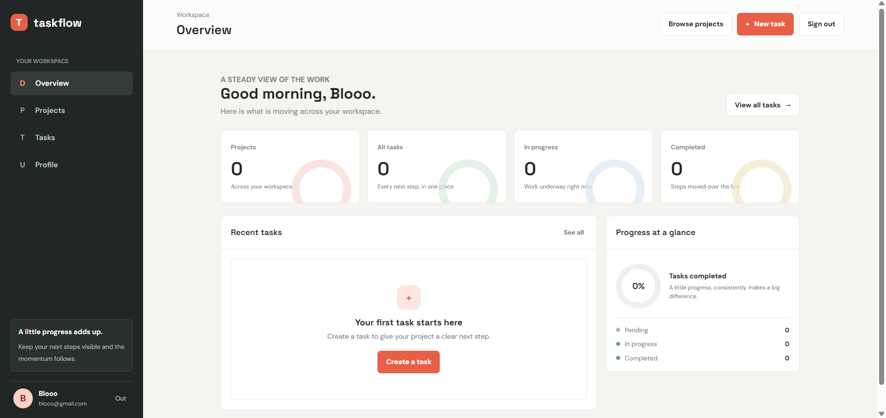
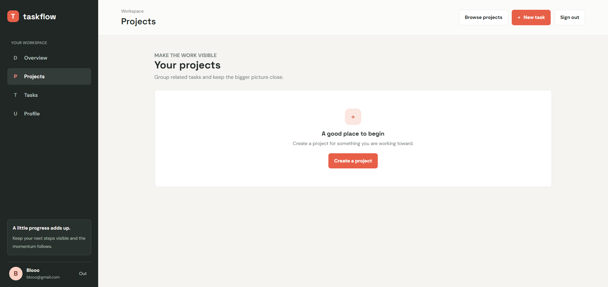

# TaskFlow

TaskFlow is a project and task management application built with Python, FastAPI, SQLAlchemy, SQLite, and plain HTML, CSS, and JavaScript. Users can organize projects, track tasks, and see live progress in a private workspace.

## Features

- Account registration, login, and logout with Argon2 password hashing and signed session cookies.
- Private projects with descriptions, deadlines, and cascading task management.
- Tasks with priority, status, due dates, search, filters, and sorting.
- A dashboard whose counts, completion percentage, and recent tasks come from SQLite.
- Responsive dashboard, projects, project details, tasks, profile, registration, and login pages.
- CSRF protection for authenticated writes, user ownership checks, database constraints, and security response headers.
- Interactive API documentation at `/docs` and OpenAPI JSON at `/openapi.json`.

## Technology Stack

- Python 3.10+
- FastAPI and Uvicorn
- SQLAlchemy 2.x and SQLite
- Pydantic request/response validation
- `pwdlib` with Argon2 for password hashing
- Vanilla JavaScript, HTML5, and CSS3
- pytest and FastAPI's TestClient for API behavior tests

## Architecture

```text
Browser (HTML/CSS/JavaScript)
        | same-origin JSON + signed session cookie + CSRF header
        v
FastAPI routes -> Pydantic schemas -> SQLAlchemy ORM -> SQLite
```

`app/main.py` configures the app, session middleware, static assets, page routes, and API routers. `app/routers/` contains auth, project, task, and dashboard endpoints. `app/models.py` owns the relational schema, `app/database.py` creates the engine and request-scoped sessions, and `app/security.py` provides password, session-user, and CSRF helpers. The frontend is served directly by FastAPI; there is no JavaScript build step.

## Database Schema

| Table | Important fields and constraints |
| --- | --- |
| `users` | `id`, unique `username`, unique `email`, `password_hash`, `created_at`; usernames are at least 3 characters. |
| `projects` | `id`, `user_id`, `project_name`, `description`, nullable `deadline`, `created_at`; user deletion cascades to projects. |
| `tasks` | `id`, `project_id`, `user_id`, `title`, `description`, `priority`, `status`, nullable `due_date`, `created_at`, `updated_at`; project/user ownership is enforced by a composite foreign key. |

Task priorities are `Low`, `Medium`, and `High`. Task statuses are `Pending`, `In Progress`, and `Completed`. Deleting a project deletes its tasks. SQLite foreign-key enforcement is enabled for every connection.

## API Reference

All private routes require a valid session cookie. Login and `/api/auth/me` return a CSRF token; include it as `X-CSRF-Token` on `POST`, `PUT`, and `DELETE` requests. API request bodies and successful responses use JSON, except successful deletes, which return `204 No Content`.

| Method | Endpoint | Purpose |
| --- | --- | --- |
| `POST` | `/api/auth/register` | Register with `username`, `email`, and `password`; returns `201`. |
| `POST` | `/api/auth/login` | Start a session with `email` and `password`. |
| `POST` | `/api/auth/logout` | End the current session; requires CSRF token. |
| `GET` | `/api/auth/me` | Return the current user and current CSRF token. |
| `GET` | `/api/projects` | List the signed-in user's projects. |
| `POST` | `/api/projects` | Create a project with `project_name`, optional `description`, and optional ISO `deadline`. |
| `GET` | `/api/projects/{project_id}` | Read an owned project. |
| `PUT` | `/api/projects/{project_id}` | Replace project fields. |
| `DELETE` | `/api/projects/{project_id}` | Delete an owned project and its tasks. |
| `GET` | `/api/tasks` | List tasks; supports `search`, `status`, `priority`, `project_id`, `sort_by`, and `order`. |
| `POST` | `/api/tasks` | Create a task with `project_id`, `title`, optional `description`, `priority`, `status`, and `due_date`. |
| `GET` | `/api/tasks/{task_id}` | Read an owned task. |
| `PUT` | `/api/tasks/{task_id}` | Replace task fields, including its project, status, priority, and due date. |
| `DELETE` | `/api/tasks/{task_id}` | Delete an owned task. |
| `GET` | `/api/dashboard/stats` | Return counts, completion percentage, and up to six recent tasks. |

`sort_by` accepts `created_at` or `due_date`; `order` accepts `asc` or `desc`. Invalid request fields return `422`, missing authentication returns `401`, failed CSRF checks return `403`, unavailable or unowned records return `404`, and duplicate account identifiers return `409`.

## Installation

Python 3.10 or later is required.

```powershell
git clone <repository-url>
cd TaskFlow
python -m venv .venv
.\.venv\Scripts\Activate.ps1
python -m pip install -r requirements.txt
Copy-Item .env.example .env
```

On macOS or Linux, activate the environment with `source .venv/bin/activate` and copy configuration with `cp .env.example .env`.

## Environment Configuration

TaskFlow loads `.env` at startup. Set the following values there or in the process environment:

| Variable | Description |
| --- | --- |
| `TASKFLOW_DATABASE_URL` | SQLAlchemy URL; defaults to `sqlite:///./taskflow.db`. |
| `TASKFLOW_SESSION_SECRET` | Random secret used to sign session cookies. Replace the example value before deployment. |
| `TASKFLOW_HTTPS_ONLY` | Set to `true` behind HTTPS so session cookies are marked Secure; defaults to `false` for local development. |

Generate a session secret with `python -c "import secrets; print(secrets.token_urlsafe(48))"`. If no secret is configured, TaskFlow creates a process-local random secret; sessions then expire when the process restarts. Never commit a real `.env` file.

## Run Locally

```powershell
uvicorn app.main:app --reload
```

Open `http://127.0.0.1:8000`. FastAPI creates the SQLite tables on startup. The dashboard redirects anonymous visitors to `/login`; create an account at `/register`. Browse the API at `http://127.0.0.1:8000/docs`.

TaskFlow is a FastAPI ASGI application. `app/main.py` exports it as `application` for Streamlit's ASGI deployment mode; it can also be served with an ASGI server such as Uvicorn.

## Tests

Tests use a separate in-memory SQLite database and exercise persistence, validation, authentication, CRUD behavior, dashboard calculations, task filtering/sorting, and cross-user access controls.

```powershell
python -m pytest -q
```

## Screenshots

Add screenshots captured from the running application to the `screenshots/` directory. The links below will display the images in GitHub once those files are committed.

| Page | Screenshot |
| --- | --- |
| Dashboard | [View dashboard](https://github.com/ThirunagariNavadeep/TaskFlow/blob/dab73a672666a099a84411e2e0abfa3140d62f48/screenshots/Dashboard.png) |
| Projects | [View projects](https://github.com/ThirunagariNavadeep/TaskFlow/blob/a582fa39410782321ac353190ddeb2552c5099af/screenshots/Projects.png) |
| Tasks and filters | [View tasks](screenshots/tasks.png) |
| Login | [View login](screenshots/login.png) |

### Preview






## Future Improvements

- Password reset and email verification flows.
- Pagination and configurable task reminders.
- Project member roles and collaboration.
- Database migrations with Alembic for deployed upgrades.
- Optional export and calendar integrations.
